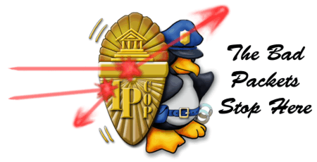
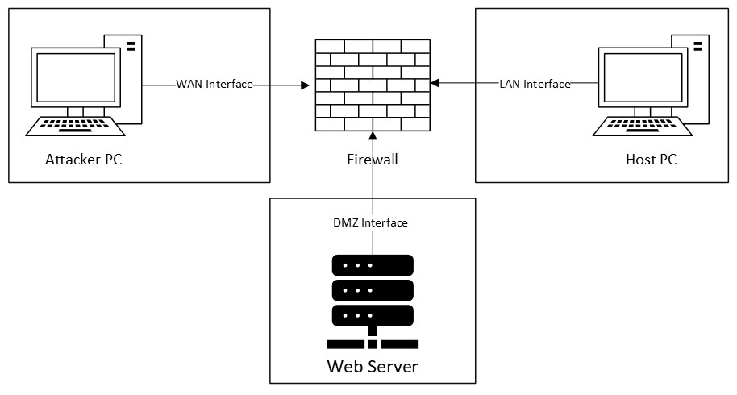

<p align="center"></p>

# Open-Source Firewalls: OPNsense, IPCop and IPFire

A group project where each of us set up a different open-source firewall in the same virtual testbed, attacked it from the outside, hardened it, and then ran the same attacks again to see what changed. We then compared the three firewalls side by side.

Built as a group project for *Network Security* (CYSC H1001) at TU Dublin, with a report, a presentation and a live demo of the tests.

| Firewall | Set up and tested by |
|----------|----------------------|
| OPNsense | Adam Lamont |
| IPCop | Roisin Aylward (me) |
| IPFire | Lexie Walsh |

---

## 📂 Repository Structure

```
OpenSourceFirewalls/
├── documentation/
│   ├── B00168689RoisinAylwardnetsecurity.pdf       # Group report
│   ├── Network Security Project Presentation.pdf   # Group presentation
│   ├── topology.jpg                                # Testbed diagram from the report
│   └── image.png                                   # IPCop logo
└── scr/                                            # IPCop's graphs during my floods after reconfiguration
    ├── flood/                                      # hping3 ICMP flood
    └── randsource/                                 # hping3 ICMP flood from random source IPs
```

---

## 🖧 Testbed

<p align="center"></p>

Each firewall sat between three networks:

- **WAN:** the outside network (NAT to the internet), where the attacker was
- **DMZ:** an Apache web server on Ubuntu, with HTTP port-forwarded to it
- **Internal:** a host PC, for all other devices

The attacker ran Kali Linux. Each firewall started from a base configuration that let every network reach the internet and talk to the others, and we ran every attack before and after adding rules and turning features on or off.

---

## 🧪 Tests

All of the attacks came from the WAN side, so the attacker had no physical or internal access.

| Attack | What it tests | Tools |
|--------|---------------|-------|
| Reconnaissance | Gathering information about the network to find weaknesses | Nmap, ping |
| Denial of service | ICMP floods and HTTP floods | hping3, wrk |
| Attacks on the firewall itself | SSH, the most likely way to manage a firewall remotely | SSH logins, Hydra |

---

## 🔥 My Part: IPCop

IPCop is an open-source Linux firewall forked from Smoothwall. It's now considered obsolete: its last version, 2.1.9, was released in 2015. It names its networks by colour: green for the internal network, blue for an optional semi-trusted wireless network, orange for an optional DMZ, and red for the internet or any other untrusted network.

**Starting point.** I managed IPCop through its web interface from an Xubuntu VM on the green network. SSH was enabled on IPCop (it uses port 8022, not 22), and the firewall rules allowed SSH to IPCop from the red network and port-forwarded HTTP to the web server. The attacker was a Kali Linux VM on the WAN, targeting IPCop's red address, 192.168.56.101.

**Reconfiguration.**

- IPCop's last version no longer includes Snort, so instead I added a firewall rule to drop ICMP packets from the red network, to block ping and hping3 floods.
- HTTP traffic goes into the Medium traffic-shaping priority group by default (607 Kbit guaranteed). I moved it to the Low priority group (405 Kbit guaranteed) to minimise the impact of DoS attacks.
- The web interface can't limit login attempts before a timeout, allow connections only at certain hours or on certain days, or take more than one source per rule. So I removed the rule allowing SSH from the red network. Red traffic is dropped by default anyway, but I added an explicit deny rule for clarity.

**Before and after:**

| Attack | Before reconfiguration | After reconfiguration |
|--------|------------------------|-----------------------|
| Nmap scan (all ports, OS detection, traceroute) | Ports 80 (Apache on Ubuntu) and 8022 (SSH) open. OS detection identified a Linux firewall but guessed IPFire | Only port 80 open. Still identified as Linux, but no longer as a firewall or as IPFire |
| Ping and hping3 | Replies received | No response |
| hping3 flood (20 minutes) | Up to two thirds of the CPU and 2.8% of memory. 2.033 Mbps in, 18.934 kbps out | 5.17% CPU and 2.21% memory. 1.93 Mbps in, 21.574 bps out |
| hping3 flood from random source IPs (20 minutes) | 17% CPU and 9.51% memory. 24.189 Mbps in, 22.910 bps out | 12.12% CPU and 8.84% memory. 29.718 Mbps in, 27.789 bps out |
| wrk HTTP flood (20 seconds) | 190.84 MB of HTTP traffic from 18,315 requests | 2.30 MB of HTTP traffic from 220 requests |
| SSH brute force (Hydra with the RockYou list) | No lockout policy, so Hydra found the basic root password | SSH can't be reached from the red network, and no rejection is sent back |

IPCop's own CPU, memory and traffic graphs during the floods after reconfiguration:

**hping3 flood**

<p align="center">
  
  
  
</p>

**hping3 flood from random source IPs**

<p align="center">
  
  
  
</p>

---

## 📊 Comparison

| Attack | OPNsense | IPCop | IPFire |
|--------|----------|-------|--------|
| Reconnaissance | Partially mitigated | Partially mitigated | Mitigated |
| ICMP flood | Not mitigated | Partially mitigated | Mitigated |
| HTTP flood | Mitigated | Mitigated | Mitigated |
| SSH attacks | Mitigated | Partially mitigated | Mitigated |

The report explains each result, including how OPNsense and IPFire were configured.

---

## 📄 Report and Presentation

- The full [group report (PDF)](documentation/B00168689RoisinAylwardnetsecurity.pdf) covers the testbed, each firewall's configuration, the attacks before and after, and the comparison. My section is the IPCop chapter.
- The [presentation (PDF)](documentation/Network%20Security%20Project%20Presentation.pdf) is the one we gave in the lab.
